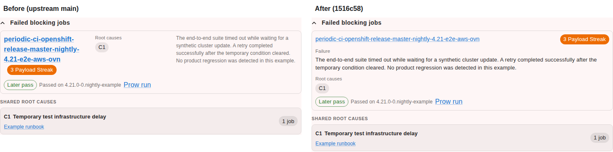
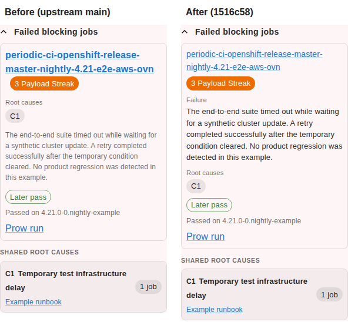

# TRT failed-job layout evidence

These images compare the upstream failed-job panel with the redesigned panel. They use the same capture-only synthetic fixture in both views. The example contains a realistic-length periodic job name, a fictional multi-sentence failure, one fictional root cause, a fictional later pass, and only `example.com` links. No production or private data is present.

## Desktop comparison

Viewport: 1440 x 900. The image contains complete panel screenshots at their native resolution.



## Narrow comparison

Viewport: 390 x 844. The image contains complete panel screenshots at their native resolution.



## Capture and validation

The implementation and upstream main were served on separate local ports with the identical mocked response and light theme. The complete failed-job panel was captured with Playwright locator screenshots:

```sh
npm ci --no-audit --ignore-scripts
npm run start -- --host 127.0.0.1 --port 3031
npm run start -- --host 127.0.0.1 --port 3032
npx playwright test -c pr-evidence-playwright.config.ts
```

The browser assertions checked that the job link, failure text, root-cause action, streak badge, and later-pass link were visible. They also checked `scrollWidth <= clientWidth` for the failed-job panel and row. The changed view additionally required the job name to be a heading link and the failure block to occupy more than 90% of the row width.

Measured widths:

| View | Row width | Failure width | Failure share |
|---|---:|---:|---:|
| Before desktop | 717 px | 290 px | 40.5% |
| After desktop | 717 px | 701 px | 97.8% |
| Before narrow | 282 px | 266 px | 94.3% |
| After narrow | 282 px | 266 px | 94.3% |

All four capture checks passed. The two comparison images place the original panel PNGs side by side without rescaling or cropping.
